# Tyflix

Tyflix is a web app that puts a real front door on my Plex server. You can browse, request a title, see what's already in the library, and play it, all behind a Plex sign-in.

It sits on top of Seerr, the request manager in the Overseerr and Jellyseerr family. Seerr passes requests to Radarr and Sonarr, the apps that download and organize movies and TV shows. Tyflix adds the parts Seerr leaves thin for what I needed: poster-forward browsing, in-browser playback, per-user analytics, and an admin view of the server itself. The point was that nobody in my house should ever have to open Radarr.

**Live:** [tyflix.tylerte.dev](https://tyflix.tylerte.dev). Signing in needs a Plex account with access to my server.

**Status:** deployed, in daily use, and still being built. See [Status and roadmap](#status-and-roadmap).

**Reading the code?** Start with [docs/CODE_TOUR.md](docs/CODE_TOUR.md). It names the ten files that carry the architecture, gives the order to read them in, and covers the design decisions worth arguing with.

## Screenshots

**Discover.** Trending, popular, and upcoming titles from TMDB (The Movie Database), with live Plex availability on top. This is the popular TV view. Green means the title is already on the server, and amber means part of it is.

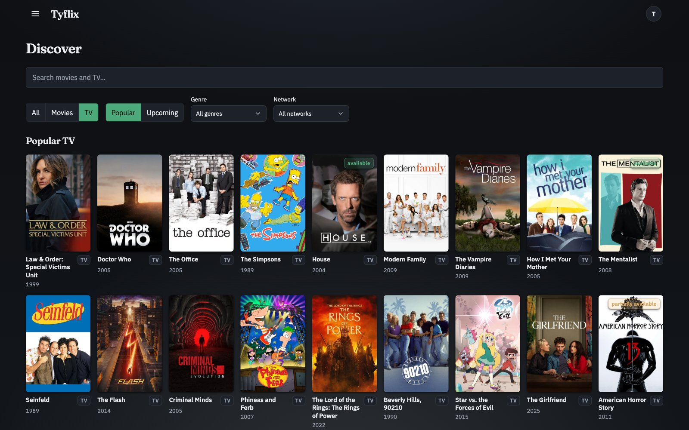

**Library.** What's actually on the server, Plex-style, opening on a Continue Watching rail. Search by title, sort, filter by genre or unwatched, jump with the A-Z rail, and resize the posters. Progress bars and watched badges come live from Plex.

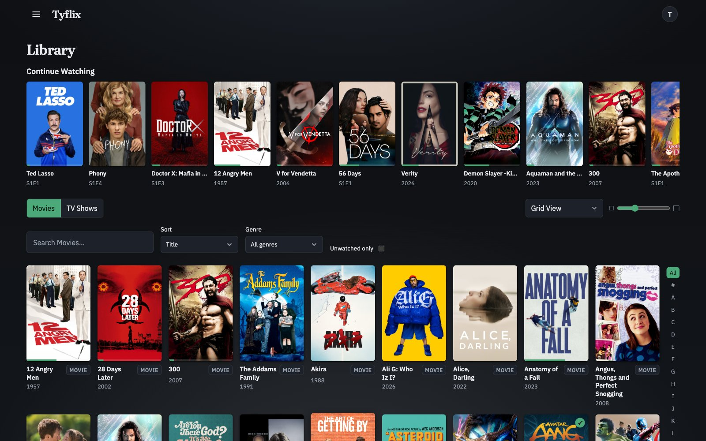

**Search.** Type a few letters and the whole library filters, not just the page on screen, because the filtering runs on Plex. It matches anywhere in the title, so "dragon" finds every Dragon Ball film without me spelling one out.

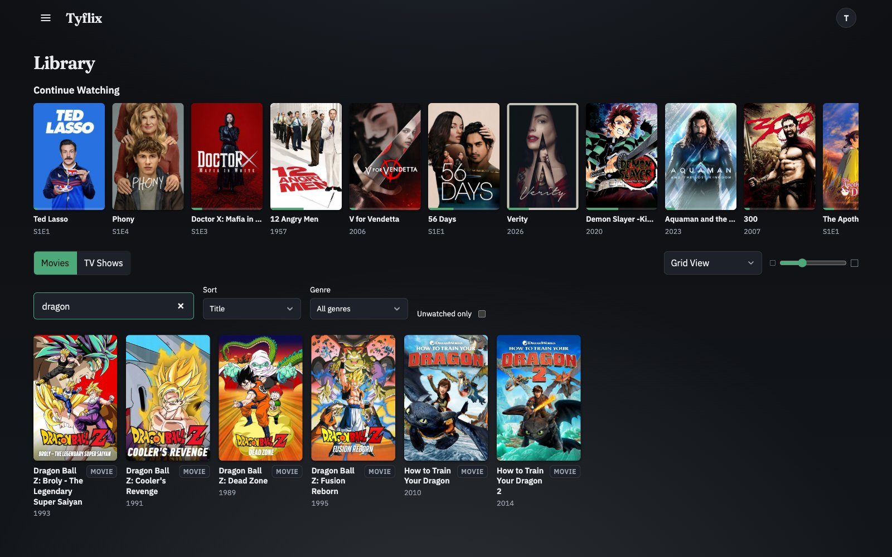

**Title page.** An edge-to-edge backdrop with the artwork, overview, credits, availability, and one button: Play if the server has the title, Request if it doesn't.

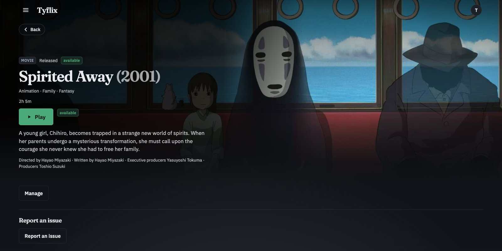

**Episodes.** A show's title page lists its episodes as tiles, one season at a time, and each tile plays its episode. On desktop the tiles sit in a rail with side arrows, a scroll bar, and a count of the episodes in view.

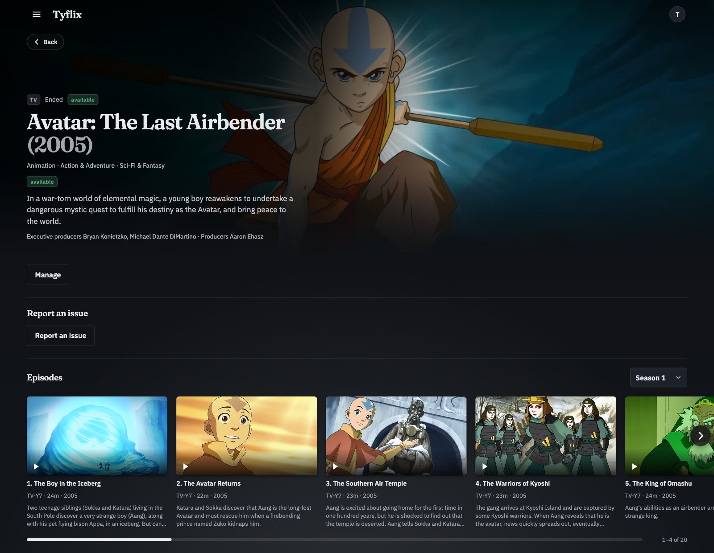

**In-browser player.** Movies and episodes stream from Plex, transcoded on the fly. The control bar is custom: 5-second skip, casting, and a settings menu for speed, quality, audio track, subtitles, and auto-play. Under an episode, Previous and Next links step through the season.

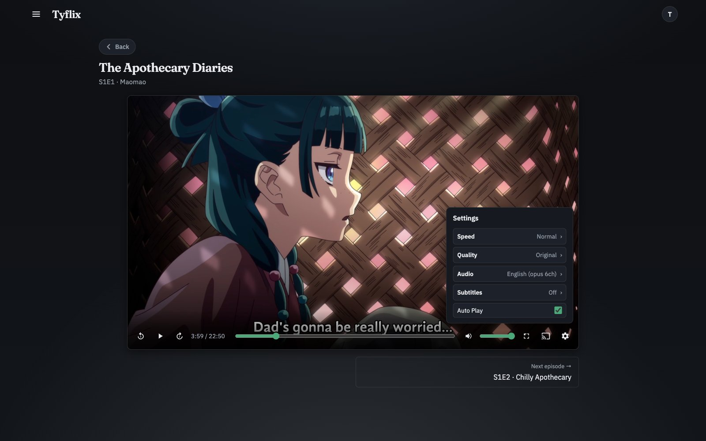

**Resume where you left off.** Playback position syncs back to Plex, so a half-watched title offers to pick up at the exact second you stopped. It doesn't matter whether you last watched in Tyflix or on the TV in the other room.

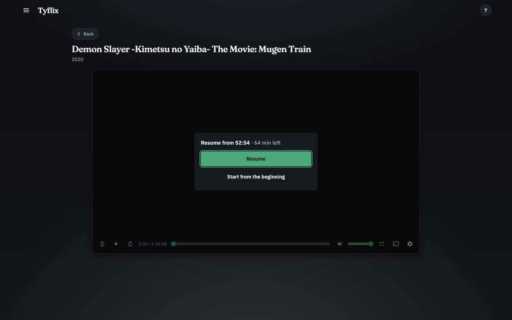

**Up Next.** At Plex's credits marker, a Plex-style card offers the next episode. In the last 30 seconds it counts down, and when the episode ends, the next one starts.

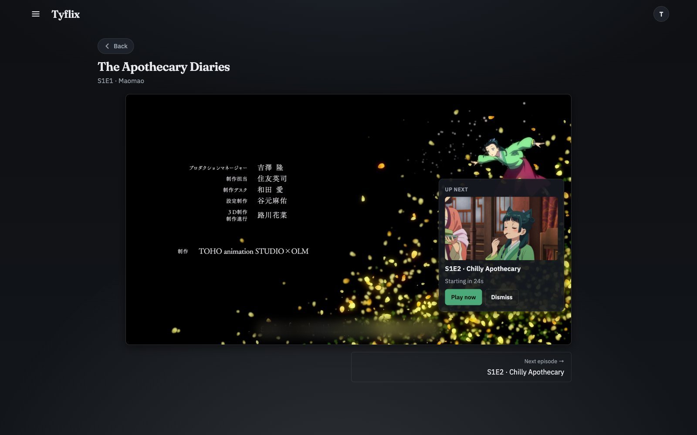

**Home.** Your own watched-versus-requested numbers: how much you asked for, how much you actually watched, and how much is sitting there untouched.

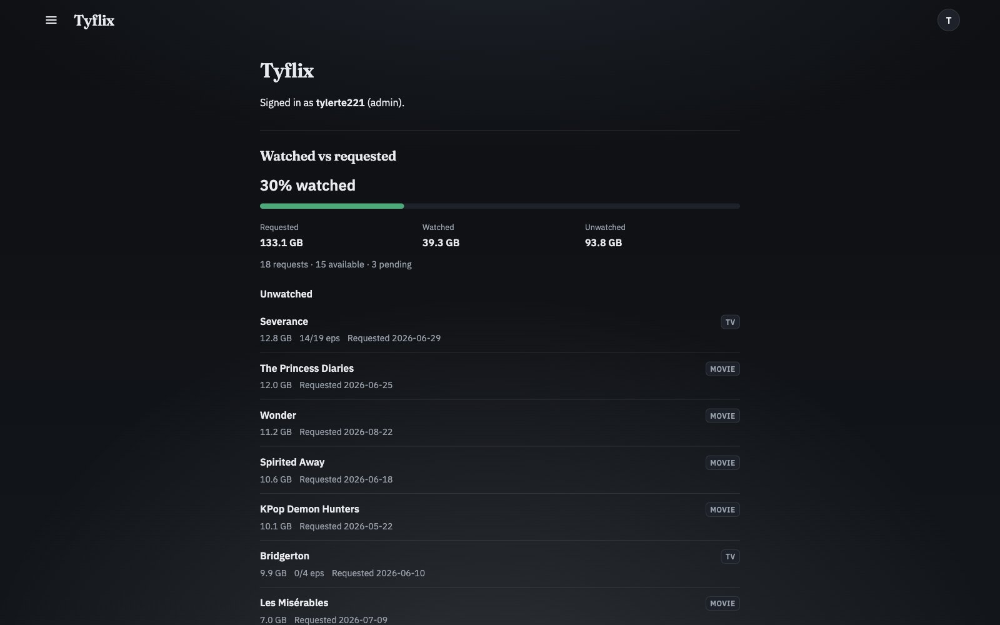

**Admin: system and storage.** Host CPU, memory, load, temperatures, GPU transcode engines, and per-volume storage, proxied live from the server.

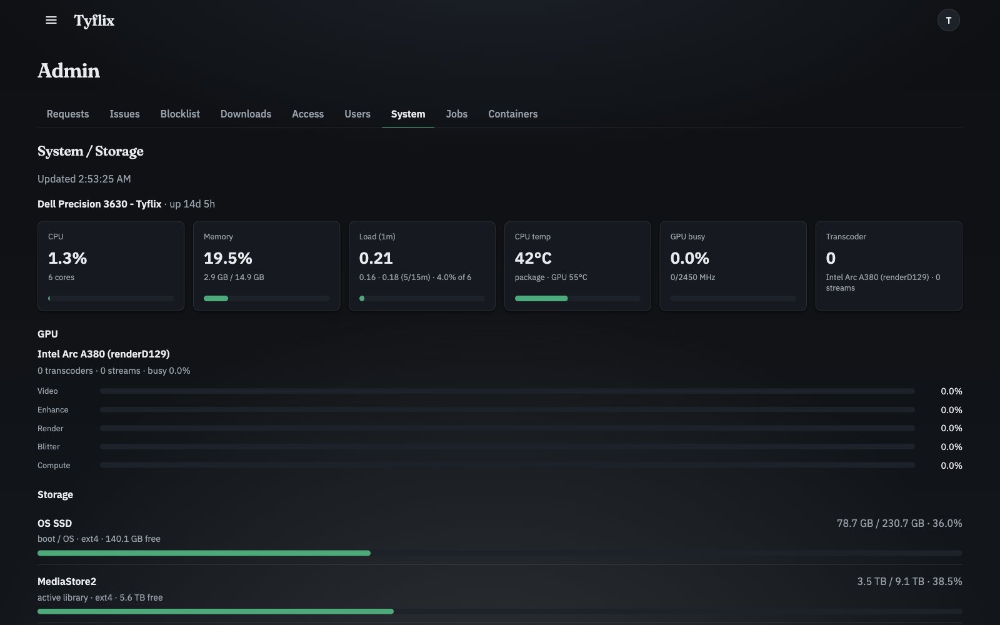

**Admin: per-user analytics.** The same watched-versus-requested split across every account, with a posture flag for people who request far more than they watch. Other users' names are blurred here.

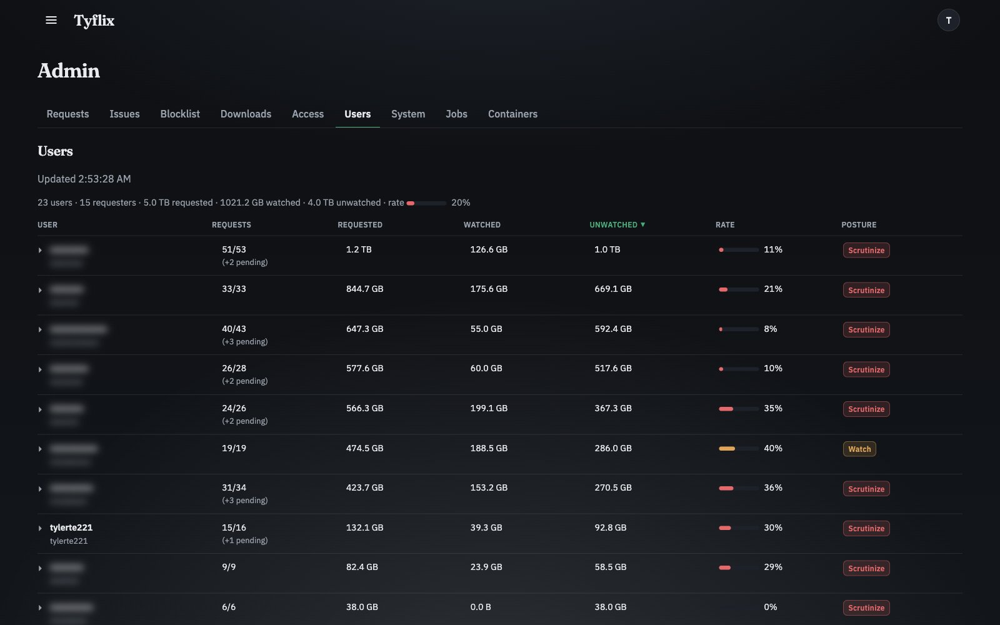

**On a phone, installed.** Tyflix installs to the home screen and runs without browser chrome, with its own icon and its own launch screen. The app switcher treats it as a separate app, not a Safari tab. This is an iPhone. Android behaves the same, and Chrome there offers a real Install button instead of burying it in a share sheet. The wallpaper and other apps are blurred because the phone isn't mine.

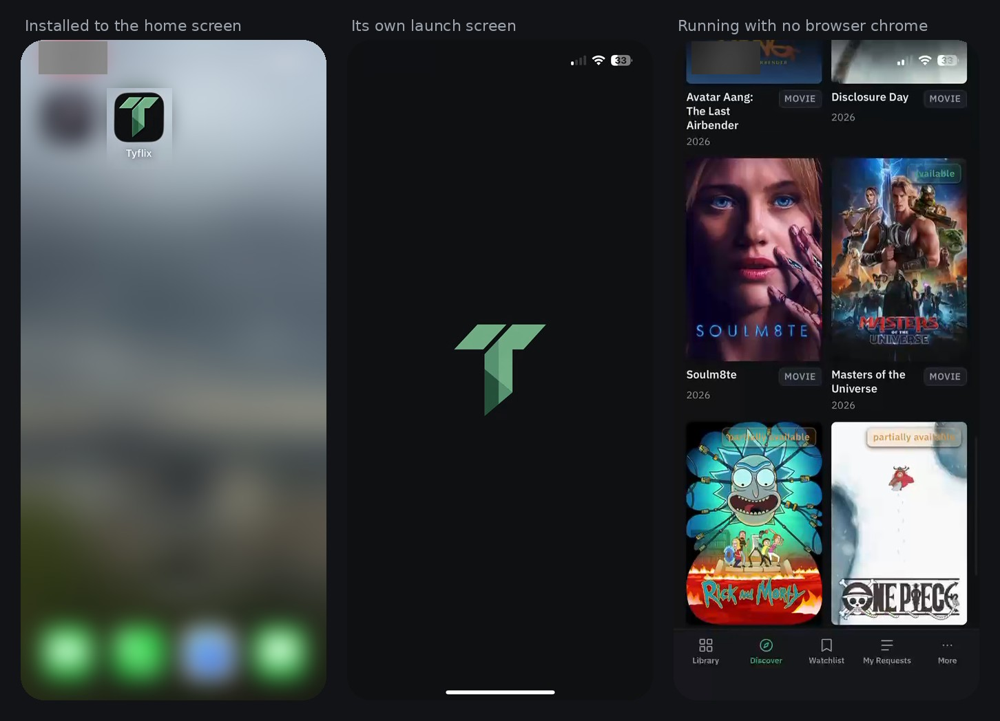

Cold launch, from tapping the icon to the launch screen:

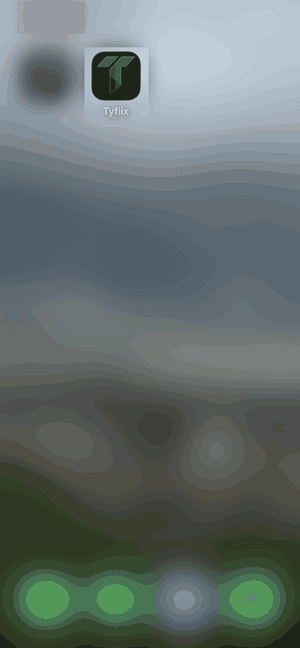

## What else it does

Beyond what's in the screenshots:

- **Discovery.** Search, genre browsing, recommendations, cast and crew, collections, and studio and network pages, all from TMDB.
- **Requests.** Requests go through Seerr to Radarr and Sonarr, which do the downloading and library management. Tyflix doesn't reimplement any of that. You also get your Plex Watchlist and your request quota, and admins can pick a quality profile when they request.
- **Problem reports.** Report a problem with a title, like bad audio or the wrong cut, and follow it through to resolution.
- **Player extras.** The arrow keys skip 5 seconds, and so does a double-tap on a phone. Plex remembers the audio track you pick. A Settings page controls whether pressing Play goes fullscreen. On phones, a show's episodes stack instead of sitting in a rail.
- **Playback that recovers.** If a stream dies mid-play, the player restarts it at the same spot instead of showing an error. While you're paused, it keeps Plex's transcode session alive.
- **Casting.** Cast to a Chromecast from the player. Playback moves to the TV and keeps reporting progress to Plex. Stop casting and the browser picks up wherever the TV got to.
- **Access requests.** People who don't have access yet can ask for it. A short form at `/request-access` lands in the admin console, and one approval sends a real Plex library invite.
- **Media removal.** Admins can remove a whole movie or series, or just one season or episode. Removing a title also blocklists it, so the watchlist sync that runs every few minutes doesn't quietly download it again. The Blocklist tab in the admin console undoes that.
- **The rest of the admin console.** Approve or decline everyone's requests and see their problem reports. If Transmission is configured, a Downloads tab shows its torrents and transfer rates and can start or stop a torrent. Other tabs show the host's scheduled jobs and how they last ran, and the health of its Docker containers and system services.
- **Getting around.** Badges on My Requests, My Issues, and Admin count what's waiting. Seerr's emailed links open the matching Tyflix title page, and signing in returns you to the page you asked for.

## Architecture

Tyflix is one Node service that serves a JSON API and the built React app from the same origin. It's a layer over Plex and Seerr, not a second copy of either. Wherever I can, I'd rather wire up a tool that already works than rebuild it.

- **Frontend:** React, Vite, and TypeScript. Dark and poster-forward, with a top bar and menu drawer on desktop and a bottom tab bar on phones.
- **Backend:** Node, Express, and TypeScript. The server holds every credential and talks to these upstream services:
  - Plex, for accounts, the library, and playback
  - Seerr, for requests, availability, issues, watchlists, and user permissions
  - Sonarr, only to remove a single season or episode, which Seerr has no API for
  - TMDB, for discovery metadata and poster art
  - a small host-metrics service that feeds the admin console
  - Transmission, if configured, for the Downloads tab
- **Sign-in:** people sign in with their Plex account through Plex's PIN flow. The browser runs that flow against plex.tv itself and posts the resulting token to the server once. The server checks the token with plex.tv and Seerr, then sets a signed, httpOnly session cookie. The cookie carries the Plex token encrypted with AES-256-GCM, so only the server can read it.
- **Playback:** the server mints a short-lived Plex *transient* token from the user's own token and hands the browser Plex's own `plex.direct` addresses. Video then goes straight from Plex to the player in the page and never touches the tunnel. Plex transcodes on demand.
- **Deployment:** Docker on a home server, on the same Docker network as Seerr, reachable from anywhere through a Cloudflare Tunnel. No inbound ports are open on the home network, and TLS ends at Cloudflare's edge. Every push to main runs both test suites. If they pass, a GitHub Actions job joins my Tailscale network and starts the deploy over SSH, with a key that can run only the deploy command.

```
Browser --https--> Cloudflare edge --tunnel--> cloudflared --> Tyflix (Node)
  |                                                              |-> Seerr --> Radarr / Sonarr
  |                                                              |-> Sonarr (season and episode removal)
  |                                                              |-> Plex
  |                                                              |-> TMDB
  |                                                              |-> host metrics
  |                                                              |-> Transmission (optional)
  `-------------------- video, direct to Plex over HTTPS ---------------------------->
```

Only the control plane goes through the tunnel. Video streams straight from Plex to the browser over HTTPS, and the sign-in handshake runs straight between the browser and plex.tv.

## Tech stack

- TypeScript in the browser and on the server
- React 19 and Vite, with React Router, and hls.js for in-browser playback
- Node 22 and Express 5
- Node's built-in test runner for the server, and Vitest, jsdom, and Testing Library for the web app
- Helmet and express-rate-limit for security headers and request throttling
- Docker for packaging, Cloudflare Tunnel (cloudflared) for access, and GitHub Actions for test-then-deploy
- Integrations: Plex, Seerr, Sonarr, TMDB, and Transmission, plus Radarr through Seerr

## Notable engineering decisions

**Public access with no inbound port open.** The app runs at home and is reachable from anywhere, yet the router accepts no unsolicited inbound traffic. The obvious way to publish a home service is a port forward on the router, which puts that service straight on the public internet. I didn't want that, so access runs outbound-only, through a Cloudflare Tunnel.

A small connector, cloudflared, sits next to the app and dials out to Cloudflare's edge, holding a connection open from the inside. When a request arrives for the public hostname, Cloudflare pushes it back down that open connection, and the connector hands it to the app over the local Docker network. Every connection starts inside the network, and TLS and edge filtering happen at Cloudflare. It's the same shape as an enterprise pattern like SAP Cloud Connector reaching SAP BTP: the on-premises side opens the tunnel outbound, and the cloud reverse-invokes back through it. The service is publicly reachable, and the perimeter stays closed.

**Video skips the tunnel.** Everything else rides the tunnel, and video is the deliberate exception. Proxying a movie through Cloudflare would be slow and outside Cloudflare's terms for that path, so playback streams straight from Plex to the browser. When someone presses Play, the server mints a short-lived Plex *transient* token from that user's own token. It returns the token with Plex's direct addresses for the server, one local and one remote, so the player uses whichever it can reach. The server never hands the long-lived token to the player. Plex transcodes on demand, forced to H.264, so anything in the library plays in a browser, whatever codec it was ripped in.

**Playback that recovers on its own.** Plex ends an idle transcode session about 3 minutes after its last request, and a paused player requests nothing, so a long pause used to kill the stream. Now the player pings its session every 30 seconds while it's idle. In testing, that kept an idle session alive for 25 minutes. If a stream dies anyway, say because the laptop slept, the player gets a fresh token and session from the server and restarts at the same position. It waits 0, 3, 10, then 30 seconds between attempts, shows "Reconnecting…" while it works, and stops after 4 restarts in 5 minutes.

**Rate limiting that sees the real client.** Behind the tunnel, every request arrives from the tunnel's address, so a naive per-IP limiter treats all traffic as one client. Tyflix's limiters key on the `CF-Connecting-IP` header instead. Cloudflare sets and overwrites that header, so a client can't forge it, and the limiters fall back to the socket address in local development. The two endpoints that accept data without an account, the access-request form and the sign-in hand-off, have tighter limits of their own on top.

I tuned the main limit after I throttled myself. The busiest admin tabs poll every 5 seconds, and an early limit of 200 requests per 15 minutes locked me out of my own admin console inside one window. It's 1,000 now.

**Security that doesn't depend on the code being private.** All authorization happens on the server. Every route behind sign-in checks the session, and admin routes also check an admin permission bit that mirrors Seerr's model. The cookie carries the Plex token encrypted, and only server code can decrypt it.

The server also doesn't trust the permissions saved in the cookie. On every request it checks a revocation list, then reads the user's current permissions from Seerr, with a 10-second cache for bursts. So logging out ends that user's sessions on every device, and a demoted admin loses access within seconds.

Security headers ship a Content-Security-Policy that allows only what the app loads. Posters come from TMDB, fonts and the Cast SDK from Google, and video and artwork from Plex's `plex.direct` hosts. Sign-in calls go to plex.tv, and everything else stays on the same origin. The one awkward exception is the Plex sign-in popup. It needs a Cross-Origin-Opener-Policy loose enough that the page keeps a handle on the popup and can close it once sign-in completes.

**Letting strangers ask for access without opening anything up.** Apart from sign-in, the request form is the only part of the app you can reach without an account. That makes it the only part anyone can abuse. I skipped the CAPTCHA, because an abusive submission is harmless: nothing happens until I approve it. No email goes out, no Plex call fires, and no account gets made. It's a row that only I see.

What's left is a crawler hammering the form. A hidden honeypot field plus a cap of 5 submissions per IP per hour deals with that, without asking real people to prove they're human.

Approving calls Plex's sharing API to invite the email and share whichever libraries I picked. A denial stops blocking a new request after 90 days, so a no isn't permanent. Loading the queue also checks Plex, at most once a minute, so an invite accepted from the email or the Plex app shows as accepted instead of sitting at "invited" forever.

**Joining two ID systems.** Discovery is keyed by TMDB ID, and Plex by its own rating keys. Availability and playability come from matching the two through Seerr's media records. That's how the app shows accurate status instead of guessing by title.

**Making it installable, and the 40 images iOS wanted.** A web app manifest does most of the work. Chrome starts offering a real Install button, and the app opens without any browser chrome. Android even generates the launch screen from the manifest's background color. iOS ignores that color and won't generate a launch screen, so an installed app flashed white on every launch until I added `apple-touch-startup-image` links. Those have to match the device's window size exactly, which means one image per screen size per orientation: 40 files covering 20 device classes. I generated them from the icon and cut them to an 8-color palette, which took the set from 1.8 MB to 533 KB.

Before anyone tested it on a real phone, I checked the media queries by running them in WebKit under each device's metrics. That caught nothing, but it made the later check on an actual iPhone a formality instead of a coin flip.

There's no service worker, on purpose. Tyflix is a thin client over Plex and Seerr, and every screen needs a live upstream. An offline shell would only make the error page prettier, and it would add a cache to invalidate.

## Run it locally

You need Node 22.22 or later. The repo pins 22.23.2 in `.node-version`.

```bash
npm install
cp .env.example .env     # then fill it in
npm run dev              # server on :4000, Vite on :5173
```

`npm run dev` runs the server and the web app together, and Vite passes `/api` calls through to the server. To do anything useful, the server needs real Plex, Seerr, and TMDB access. It checks its settings at startup and exits if any of its 11 required variables is missing. Those cover Plex, Seerr, Sonarr, TMDB, the host-metrics service, the session secret, and the session-revocation file. The file `.env.example` lists all 18 variables with comments, including the optional ones that turn on access requests and the Downloads tab.

```bash
npm test                 # web tests (Vitest), then server tests (node --test)
npm test -w server       # compile, then run the server tests only
npm test -w web          # type-check, then run the web tests only
npm run build            # web app (tsc + Vite build), then the server (tsc)
```

In production the server also serves the built app, so there's one process and one port.

## Status and roadmap

Tyflix is deployed and in daily use on my home server, and it's still an active work in progress. It covers most of Seerr's user-facing features, plus a few things Seerr doesn't do, like the per-user watched-versus-requested analytics. The server has 636 tests and the web app 533.

Recent work, newest first:

- **November 2026:** side arrows, a scroll bar, and an episode count for the episode rail. Playback that recovers from a dropped stream or a long pause. Plex now remembers the audio track you pick. An edge-to-edge backdrop on title pages.
- **October 2026:** episode tiles with a season picker, and a top bar and menu drawer in place of the desktop sidebar. Previous and Next links under the player. Seerr's emailed links open the Tyflix title page, and signing in returns you to the page you asked for. A security fix that refuses compressed request bodies before anything decompresses them.
- **August 2026:** a Downloads tab for Transmission. 5-second skip from buttons, arrow keys, or a double-tap. Fullscreen on Play, with a Settings page to turn it off. I moved Plex's PIN handshake into the browser, which stopped Plex from showing a security alert at sign-in. Count badges on My Requests, My Issues, and Admin.

Before that, I made Tyflix installable on a phone, which took 40 launch-screen images to satisfy iOS. Earlier came admin media removal, including the per-season and per-episode deletion Seerr doesn't offer, and a blocklist so a removal sticks against the watchlist sync. Before that came a mobile overhaul, Library search, self-serve access requests, and Chromecast casting. Earlier still came the in-player control bar, Up Next, hardware transcoding on the server's Arc GPU, and progress sync back to Plex. That last one made watch state per user instead of the owner's, which is what makes the Continue Watching rail and the progress bars mean anything.

Next up: an automatic bitrate cap for constrained connections, and AirPlay, so casting also works from Safari and iOS.

## Scope and affiliation

Tyflix is a personal, self-hosted project, and it isn't affiliated with Plex. It doesn't host or distribute media. It manages access to a private Plex library. This repository is application code only, and deployment details specific to my own network stay out of it.
