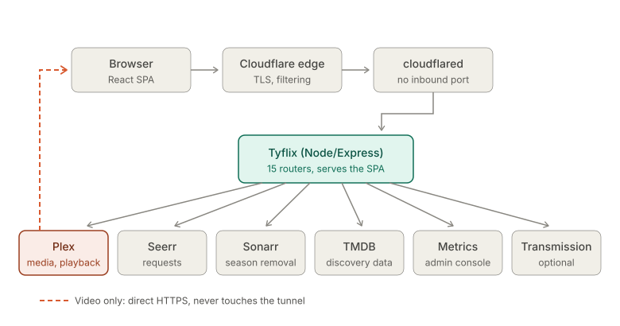

# Code tour

_Last verified against `7090f27`, 2026-11-15._

This tour is for engineers reading the Tyflix code, whether to work on it or to see how it's built. It shows which files carry the architecture, the order to read them in, and the decisions behind them.

Tyflix has 129 source files and about 39,400 lines, not counting test files, split between a Node/Express server and a React single-page app (SPA). Ten files carry the architecture, and the rest hang off them. The size is lopsided, so budget your time. Six files hold 11,731 of those lines, 30% of the total: `WatchPage.tsx` (2,742), `AdminPage.tsx` (2,714), `PlayerControls.tsx` (1,773), `plex/server.ts` (1,705), `seerr/client.ts` (1,693), and `tmdb/client.ts` (1,104).

Every source file starts with a header comment that says what it is and where it fits. Once you're in the code, those headers keep you oriented without coming back here.

**Contents**

- [Read this first](#read-this-first)
- [The system on one page](#the-system-on-one-page)
- [The spine: ten files to read first](#the-spine-ten-files-to-read-first)
- [Decisions worth asking about](#decisions-worth-asking-about)
- [Reading paths by topic](#reading-paths-by-topic)
- [Conventions you'll see everywhere](#conventions-youll-see-everywhere)
- [File reference by topic](#file-reference-by-topic)
- [Where the rest of the docs are](#where-the-rest-of-the-docs-are)

## Read this first

The [README](../README.md) covers what the product does and has screenshots. Its [Run it locally](../README.md#run-it-locally) section has the install and test commands. Read it before any code, because the rest of this tour assumes you know what the app does from a user's point of view.

Two things to know before you open a file:

**This is a layer, not a rebuild.** Plex holds the media and does the transcoding. Seerr runs the request pipeline into Radarr and Sonarr. TMDB (The Movie Database) supplies discovery metadata. Tyflix orchestrates those three and adds what none of them does: poster-forward browsing, in-browser playback, per-user analytics, self-serve access requests, and an admin console. If you go looking for the downloader, you won't find it here, and that's on purpose.

**Most of the complexity is one problem.** Discovery is keyed by TMDB ID, and Plex by its own `ratingKey`. The app has to match the two before it can say "you can play this" instead of "this movie exists somewhere." A surprising amount of the code is that join.

### Words this tour uses

| Term | Meaning here |
|---|---|
| Plex Media Server (PMS) | The server at home that stores the media and transcodes it. |
| plex.tv | Plex's cloud service for accounts, sign-in, and library sharing. |
| `plex.direct` | Plex's own HTTPS hostnames for a server. The browser streams video from these. |
| `ratingKey` | Plex's ID for an item in the library. |
| TMDB | The Movie Database, the source of discovery metadata and posters. |
| Seerr | The request manager from the Overseerr and Jellyseerr family. Tyflix uses it for requests, availability, issues, watchlists, and user permissions. |
| Radarr, Sonarr | The apps that download and organize movies (Radarr) and TV (Sonarr). Tyflix reaches them through Seerr, and calls Sonarr directly only to remove a single season or episode. |
| Account token | The token plex.tv gives a user at sign-in. |
| Per-server token | The token a shared user needs for this particular server. See [Per-server Plex tokens](#per-server-plex-tokens). |
| Transient token | A short-lived Plex token that the server mints for each play. |
| Play descriptor | What the server returns when someone presses Play: a transient token, Plex's direct addresses, the stream URLs, the audio and subtitle tracks, and the resume position. |
| Upstream | Any service the server calls: Plex, Seerr, Sonarr, TMDB, Transmission, or the host-metrics service. |

## The system on one page

One Node process serves the JSON API and the built React app from the same origin.



The video path that bypasses the tunnel is deliberate. [Video does not go through the tunnel](#video-does-not-go-through-the-tunnel) explains why. Sign-in also skips the tunnel, because the browser runs Plex's PIN handshake directly with plex.tv.

**What Tyflix stores.** There's no database. Tyflix keeps three small JSON files on disk:

- the session-revocation list (`sessionRevocation.ts`), always on
- per-user preferences (`preferences/store.ts`), always on
- the access-request queue (`accessRequests/store.ts`), only when that feature is on

Each store reads its file into memory at startup and serializes its writes. Every write lands in a temp file that's renamed over the real one, so a crash mid-write leaves the old file intact. Everything else is either carried in the signed session cookie or fetched from an upstream, with short in-memory caches where a burst would repeat the same call. Watch progress, for instance, belongs to Plex. The server only reports it there.

Server layout, in dependency order:

```
config.ts         env in, validated config out; exits if anything's missing
   ↓
index.ts          builds every client and store once, mounts every router  ← the map of the server
   ↓
middleware/       auth gates, rate limiters, and the JSON body parser
routes/           15 routers, one per API area
   ↓
plex/ seerr/ sonarr/ tmdb/ transmission/ dashboard/     typed clients for the upstreams
```

Three routers are public: auth, config, and access requests. Every other router sits behind `requireAuth` or `requireAdmin`.

The frontend mirrors it:

```
main.tsx      starts the Cast SDK, then mounts React inside BrowserRouter + AuthProvider
   ↓
App.tsx       the route table  ← the map of the frontend
   ↓
pages/        15 screens
   ↓
api/          13 clients, roughly one per server area
```

If you read only two files, read `server/src/index.ts` and `web/src/App.tsx`. They're the two tables of contents.

## The spine: ten files to read first

Ten files, in dependency order. The first five cover the architecture, and all ten cover everything load-bearing.

| # | File | Lines | Why it's here |
|---|---|---|---|
| 1 | [`server/src/index.ts`](../server/src/index.ts) | 468 | Composition root and routing table. Shows every upstream, every route, the middleware order, and which routes are public. Two mount-order rules are load-bearing. Public routes (auth, config, access requests) must mount before the catch-all `/api` 404 guard. And `/api/admin/media`, `/api/admin/blocklist`, `/api/admin/transmission`, and `/api/admin/access-requests` must mount before `/api/admin`, because Express matches path prefixes in registration order. |
| 2 | [`web/src/App.tsx`](../web/src/App.tsx) | 111 | Every URL the app answers, in three access tiers: public (`/login`, `/request-access`), signed-in (everything behind `ProtectedRoute`), and admin-only (`/admin`, with `AdminRoute` on top). It also sends Seerr's `/movie/:tmdbId` and `/tv/:tmdbId` links to the title page. |
| 3 | [`server/src/session.ts`](../server/src/session.ts) | 412 | How a signed-in user is represented: a signed cookie with the Plex account token encrypted inside it (AES-256-GCM). Also `isAdmin`, the single place admin is decided. |
| 4 | [`server/src/routes/watch.ts`](../server/src/routes/watch.ts) | 978 | Playback, ten endpoints. The most interesting is `GET /movie/:tmdbId`. It resolves a TMDB ID to a `ratingKey`, mints a transient token, and hands back Plex's direct addresses. |
| 5 | [`server/src/seerr/mediaStatusProvider.ts`](../server/src/seerr/mediaStatusProvider.ts) | 177 | 177 lines that explain half the codebase: the join from TMDB ID to Plex `ratingKey`. An in-memory cache with a 60-second lifetime, shared by the five routers that need it (discover, watchlist, issues, watch, and admin media). If Seerr is down when the cache expires, the provider returns nothing rather than the stale copy, so availability reads as unknown instead of wrong. |
|  | *Stop here if you have twenty minutes.* | | |
| 6 | [`server/src/plex/connection.ts`](../server/src/plex/connection.ts) | 267 | Resolves the `plex.direct` addresses a browser can stream from, local and remote, so the player can use whichever it reaches. |
| 7 | [`server/src/plex/transientToken.ts`](../server/src/plex/transientToken.ts) | 136 | Trades the user's token for a transient one, valid for about 48 hours or until the Plex server restarts. This is what lets video go direct while the long-lived token stays away from the player. |
| 8 | [`server/src/plex/resolvePmsToken.ts`](../server/src/plex/resolvePmsToken.ts) | 33 | 33 lines, and worth every one. A shared Plex user's account token isn't their token for this server. Getting that wrong broke playback for all 14 shared accounts at once. |
| 9 | [`web/src/pages/WatchPage.tsx`](../web/src/pages/WatchPage.tsx) | 2,742 | The browser half of playback: hls.js, resume, Up Next, previous and next episodes, the cast handoff, and recovery when a stream fails. Read its header first. It walks through the play sequence before you meet the code. |
| 10 | [`server/src/routes/auth.ts`](../server/src/routes/auth.ts) | 293 | The server half of sign-in. `POST /plex/complete` checks the token the browser got from plex.tv, confirms the account in Seerr, and issues the session cookie. The browser half is `web/src/lib/plexOauth.ts`. |

## Decisions worth asking about

These are the parts of the project where the interesting thinking is, and what I'd have had to give up to do them another way.

### Public access with no inbound port open

The app runs at home and is reachable from anywhere, yet the router accepts no unsolicited inbound traffic.

The obvious approach is a port forward, which puts a service straight on the public internet. I didn't want that, so access runs outbound-only instead.

A `cloudflared` connector sits next to the app and dials out to Cloudflare's edge, holding a connection open from the inside. When a request arrives for the public hostname, the edge pushes it back down that open connection, and the connector hands it to the app over the local Docker network. Every connection starts inside the network. TLS and edge filtering happen at Cloudflare.

It's the same shape as SAP Cloud Connector reaching SAP BTP: the on-premises side opens the tunnel outbound, and the cloud reverse-invokes back through it.

**Trade-off:** everything now depends on Cloudflare being up, and a third party sits in the path of all control-plane traffic.

**Where to look:** most deployment config, the tunnel included, lives on the server, outside this repo. The repo holds the `Dockerfile` and the deploy workflow. The tunnel still shapes the code in two visible places: the rate limiter's IP handling, and the next decision.

### Video does not go through the tunnel

Every other request rides the tunnel. Video is the deliberate exception. Proxying a movie through Cloudflare would be slow and outside Cloudflare's terms for that path, so playback streams straight from Plex to the browser.

That creates a credential problem. Four credentials are in play, and it helps to keep them apart:

1. The user's Plex **account token**, which the browser gets from plex.tv at sign-in.
2. Their **per-server token**, the one this media server accepts from a shared user. See [Per-server Plex tokens](#per-server-plex-tokens).
3. A **transient token**, minted fresh for each play.
4. The **session cookie** itself.

The account token passes through the browser once, at sign-in, and goes straight to the server. From then on, the browser holds it only inside the cookie, encrypted with AES-256-GCM, so the browser can't read it. The per-server token never leaves the server. The only credentials the browser keeps are the cookie and transient tokens.

**The fix:** when someone presses Play, the server mints a transient token from whichever token this server accepts for that user. It returns that token with Plex's own direct addresses, local and remote, and the player uses whichever it can reach. A transient token is valid for about 48 hours or until the Plex server restarts. Plex transcodes on demand, forced to H.264, so anything in the library plays in a browser however it was ripped.

**When a stream fails,** the page picks one of three responses:

- **The local address failed before any video buffered:** it switches to the remote address, since this network may be unable to reach the local one.
- **The stream was playing:** it restarts at the same position with a fresh play descriptor, which means a new transient token and a new transcode session. Restarts wait 0, 3, 10, then 30 seconds, and stop after 4 in 5 minutes. A "Reconnecting…" banner covers the wait.
- **The stream never played:** it shows an error with a connection report.

Plex also ends an idle transcode session about 181 seconds after its last request, and a paused player requests nothing. So while a stream sits idle, the page pings its session every 30 seconds to keep it alive.

**Trade-off:** a transient token does reach the browser. It's short-lived and scoped, which is the point, but it's a real widening of the trust boundary compared with proxying everything.

**Where to look:** on the server, `server/src/routes/watch.ts`, `plex/transientToken.ts`, `plex/connection.ts`, and `plex/transcodeUrl.ts`. In the browser, `web/src/lib/playbackRecovery.ts` and `lib/transcodeKeepalive.ts`.

### Sign-in runs Plex's PIN flow in the browser

Plex's PIN flow creates a PIN, sends the user to plex.tv to approve it, and polls until the PIN carries a token. Tyflix used to create and poll the PIN from the server. Plex then showed its "Security Alert" page whenever the PIN came from a different network address than the browser approving it.

Now the browser creates and polls the PIN against plex.tv itself, then posts the token once to `POST /api/auth/plex/complete`. The server checks the token with plex.tv, confirms the account in Seerr, and sets the session cookie.

**Trade-off:** the account token now passes through the browser, in memory, during sign-in. The browser never stores it, and the hand-off endpoint has its own rate limit of 20 requests per 15 minutes per IP.

**Where to look:** `web/src/lib/plexOauth.ts` and `web/src/pages/LoginPage.tsx`, then `server/src/routes/auth.ts` and `plex/client.ts`.

### Joining two ID systems

Discovery is keyed by TMDB ID, and Plex by `ratingKey`. Availability and playability come from matching them through Seerr's media records. That's how the app shows accurate status instead of guessing by title.

Title matching would have been simpler, and it would have been wrong constantly: remakes, re-releases, regional titles, and any show with a common word in its name.

**Trade-off:** it makes Seerr a hard dependency for something that isn't really about requests. If Seerr is down, availability drops to unknown rather than the app guessing.

**Where to look:** `server/src/seerr/mediaStatusProvider.ts`, then `routes/discover.ts`, where `annotateMediaStatus` layers status onto results, and `web/src/components/MediaCard.tsx`, where the availability badge renders.

### Per-server Plex tokens

A shared Plex user has an account token and, separately, a token for each server they can access. The media server accepts only the per-server token from anyone but the owner.

I stored the account token. Everything worked in testing, because I tested as the owner, and the owner's account token *is* accepted. It broke playback for all 14 shared accounts at once. Signing in again couldn't fix it, because the app would just store the wrong token again.

**Where to look:** `plex/resolvePmsToken.ts` and `plex/sharedServerAccess.ts`. The whole 33-line `resolvePmsToken.ts` exists to make the right choice hard to get wrong twice.

### Rate limiting behind a tunnel

Behind the tunnel, every request arrives from the tunnel's address, so a naive per-IP limiter treats all traffic as one client. The limiters key on `CF-Connecting-IP` instead. Cloudflare sets and overwrites that header, so a client can't forge it, and the limiters fall back to the socket address in local development. Express's `trust proxy` stays off on purpose, so a client can't spoof `X-Forwarded-For` either.

Four limiters share that key:

| Limiter | Covers | Limit per client IP |
|---|---|---|
| `apiRateLimiter` | all of `/api` | 1,000 per 15 minutes |
| `accessRequestLimiter` | the public access-request form | 5 per hour |
| `plexCompleteLimiter` | the sign-in hand-off | 20 per 15 minutes |
| `staticRateLimiter` | the built app and its files, in production | 1,000 per 15 minutes |

I tuned the main limit after I locked myself out. The admin console's busiest tabs poll every 5 seconds, and an early limit of 200 requests per 15 minutes started returning 429s to me inside one window.

**Where to look:** `server/src/middleware/rateLimit.ts`.

### Letting strangers ask for access without opening anything up

Apart from sign-in, the request form is the only part of the app you can reach without an account. That makes it the only part anyone can abuse. I skipped the CAPTCHA.

An abusive submission is already harmless, because nothing happens until I approve it. No email goes out, no Plex call fires, and no account is created. It's a row only I see. What's left is a crawler hammering the form, and a hidden honeypot field plus a cap of 5 submissions per IP per hour handles that without asking real people to prove they're human. Approving calls Plex's sharing API to invite the email and share the libraries I picked.

**Trade-off:** a determined human can still submit junk. That costs a row in a JSON file, which I judged cheaper than a CAPTCHA for every legitimate visitor.

**Where to look:** `routes/accessRequests.ts`, `routes/adminAccessRequests.ts`, `accessRequests/store.ts`, and `plex/sharing.ts`.

### Authorization is entirely server-side

The SPA hides admin navigation, but that's tidiness, not security. Nothing is protected until `requireAuth` or `requireAdmin` runs on the server. Both gates do more than check the cookie's signature:

- They check a revocation list first, on every request. Logging out records a "valid after" time for that user, so every cookie issued before it stops working, on every device.
- They then read the user's current permissions from Seerr instead of trusting the copy in the cookie. A 10-second cache absorbs bursts, like the 49 requests one Library page makes. If Seerr can't answer, the request fails with 503 rather than falling back to the cookie.

`requireAdmin` also checks the admin bit, which mirrors Seerr's permission model. The cookie carries the Plex token encrypted, and only server code can decrypt it.

This matters because the repository is public. None of the security depends on the code being secret.

**Where to look:** `server/src/middleware/auth.ts`, `middleware/revalidatePermissions.ts`, and `sessionRevocation.ts`, then `session.ts` for `isAdmin` and the cookie format.

## Reading paths by topic

Pick the topic you care about. Each path is in reading order.

**How does sign-in work?**
`web/src/pages/LoginPage.tsx` → `web/src/lib/plexOauth.ts` (the PIN, against plex.tv) → `server/src/routes/auth.ts` → `plex/client.ts` (whose token is this) → `session.ts` (cookie issued) → `middleware/auth.ts` and `revalidatePermissions.ts` (cookie checked) → `web/src/auth/AuthContext.tsx` (what the browser knows).

**How does playback work?**
`routes/watch.ts` → `plex/resolvePmsToken.ts` → `plex/transientToken.ts` → `plex/connection.ts` → `plex/transcodeUrl.ts` → `web/src/api/watch.ts` → `web/src/pages/WatchPage.tsx` → `web/src/components/PlayerControls.tsx`. For what happens when a stream fails, add `web/src/lib/playbackRecovery.ts` and `transcodeKeepalive.ts`.

**How does requesting a title work?**
`web/src/pages/MediaDetailPage.tsx` → `web/src/api/requests.ts` → `routes/requests.ts` → `seerr/client.ts`. Seerr takes it from there into Radarr or Sonarr.

**How does browsing the library work?**
`routes/library.ts` → `plex/server.ts` → `web/src/api/library.ts` → `web/src/pages/LibraryPage.tsx`. Search, sort, and filters all run on Plex's side, not in the browser. That's why typing filters the whole library rather than the page you're looking at.

**How do a show's episodes get onto its title page?**
`routes/watch.ts` (`GET /tv/:tmdbId/episodes`) → `web/src/api/watch.ts` (`fetchEpisodes`) → `web/src/components/EpisodeBrowser.tsx` (season picker and tiles) → `EpisodeRail.tsx` (arrows and scroll bar) → `web/src/lib/railGeometry.ts` (the math behind both).

**How does casting work?**
`web/src/cast/initCast.ts` → `cast-globals.d.ts` (hand-written types, since the SDK comes from a CDN) → `useCastState.ts` → `subscribeSessionReady.ts` → `loadMediaOnCast.ts` → `useCastPlayer.ts`. Cast uses DASH while the browser uses HLS, because the Cast receiver couldn't play Plex's HLS output.

**How do access requests work?**
`web/src/pages/RequestAccessPage.tsx` → `routes/accessRequests.ts` → `accessRequests/store.ts` → `routes/adminAccessRequests.ts` → `plex/sharing.ts`.

**How does removing a title work?**
`web/src/components/ManageMediaModal.tsx` → `web/src/api/admin.ts` → `routes/adminMedia.ts` → `seerr/client.ts` for a whole title, or `sonarr/client.ts` for one season or episode → `routes/adminBlocklist.ts` for the undo.

**How does the admin console work?**
`web/src/pages/AdminPage.tsx` (up to nine tabs, mapped at the top of the file) → `web/src/hooks/usePolledResource.ts` → `web/src/api/admin.ts` → `routes/admin.ts` → `dashboard/client.ts`. The Downloads tab goes through `web/src/api/transmission.ts` → `routes/adminTransmission.ts` → `transmission/client.ts` and `transmission/normalize.ts`.

## Conventions you'll see everywhere

**Factory functions with hand-rolled dependency injection.** Nearly everything on the server is `createSomething(deps)`, returning an object of methods: `createPlexClient`, `createWatchRouter`, `createSeerrClient`. There's no DI container. `index.ts` wires the real implementations, and tests pass fakes to the same factories. That one pattern is why the server's 636 tests need no module mocking.

**Routers are built, not imported.** Each file in `routes/` exports `createXRouter(deps)`. Mount paths live only in `index.ts`, so that's where to check a route's real URL.

**`res.locals.session`** carries the decoded session after `requireAuth`, with permissions freshly read from Seerr. If you see a handler read it, authentication already happened upstream.

**Upstream failures answer 502.** Each router catches its client's error type and returns 502 with the upstream message, so a Plex or Seerr outage doesn't look like a bug in Tyflix. The auth gates answer 503 instead when Seerr can't confirm who you are.

**Optional features are flags in config.** Access requests and the Downloads tab exist only when their environment variables are set. The server mounts their routes only then, and `GET /api/config` tells the SPA which features are on, so the SPA links only to routes that exist.

**Types are the documentation for shapes.** The clients convert upstream snake_case into camelCase at the boundary, so a `MediaSummary` in the frontend is the same shape the server promised. Field comments carry units and what null means. The host-metrics payloads are the exception: they pass through unchanged.

**Tests sit next to their sources.** The server has 36 `*.test.ts` files (636 tests) on Node's built-in test runner. Their fixtures came from live responses, so they're a good record of real upstream shapes. The web app has 35 test files (533 tests) on Vitest, with jsdom and Testing Library. The folder `web/src/test/` holds a fake hls.js and a fake media element, which let `WatchPage.playback.test.tsx` pin the player's behavior.

## File reference by topic

Grouped by concern. Open these when a path above leads you here. Line counts are from `7090f27`.

**Configuration and startup**

| File | Lines | What it is |
|---|---|---|
| `server/src/config.ts` | 345 | Every environment variable, validated once at startup. Fails loudly and exits rather than starting half-configured. |
| `server/src/routes/config.ts` | 40 | Public `GET /api/config`. Tells the signed-out app which optional features are on. |
| `server/src/middleware/jsonBody.ts` | 8 | The JSON body parser, with decompression off, so compressed request bodies are refused before anything decodes them. |

**Sign-in, sessions, and access control**

| File | Lines | What it is |
|---|---|---|
| `server/src/middleware/auth.ts` | 111 | `requireAuth` and `requireAdmin`, the only two gates. |
| `server/src/middleware/revalidatePermissions.ts` | 127 | The revocation check, then a fresh permission read from Seerr behind a 10-second cache. |
| `server/src/sessionRevocation.ts` | 167 | The per-user "valid after" list that makes logout sign you out everywhere. One of the three JSON-file stores. |
| `server/src/middleware/rateLimit.ts` | 120 | Four limiters, all keyed on `CF-Connecting-IP`. |
| `server/src/plex/client.ts` | 103 | plex.tv account lookup. Turns the token the browser got at sign-in into an identity. Not to be confused with `plex/server.ts`. |
| `web/src/lib/plexOauth.ts` | 174 | The browser half of the PIN handshake with plex.tv. |
| `web/src/pages/LoginPage.tsx` | 266 | The sign-in popup, the PIN polling, and the hand-off to the server. |
| `web/src/auth/AuthContext.tsx` | 179 | The browser's whole view of the session. |
| `web/src/auth/ProtectedRoute.tsx` | 85 | `ProtectedRoute` and `AdminRoute`, both layout routes. They note the page you asked for before sending you to sign in. |
| `web/src/auth/returnTo.ts` | 56 | Builds that return path and checks it before use, because history state is untrusted. |

**The Plex integration**

| File | Lines | What it is |
|---|---|---|
| `server/src/plex/server.ts` | 1,705 | The media server's HTTP API: sections, metadata, episodes, artwork, watch state, audio and subtitle choices, and timeline reports. The biggest server file, and dense with Plex quirks that the header lists. |
| `server/src/plex/transcodeUrl.ts` | 202 | Builds the universal-transcode URLs, HLS for the browser and DASH for Cast, forcing H.264. |
| `server/src/plex/sharedServerAccess.ts` | 226 | Resolves each shared user's per-server token. |
| `server/src/plex/sharing.ts` | 478 | Library sharing: invites, shareable sections, and acceptance state. |
| `server/src/routes/library.ts` | 436 | Browsing what's on the server. Five endpoints, including the artwork proxy. |

**Playback in the browser**

| File | Lines | What it is |
|---|---|---|
| `web/src/api/watch.ts` | 562 | Play descriptors, episode lists, previous and next lookups, audio and subtitle choices, timeline reports, and the Continue Watching rail. |
| `web/src/components/PlayerControls.tsx` | 1,773 | The custom control bar. Quality and audio changes restart the Plex transcode in place, and subtitles are burned in. The header explains both. |
| `web/src/lib/playbackRecovery.ts` | 198 | The pure rules for a failed stream: fail over, restart, or give up, plus the restart budget. |
| `web/src/lib/transcodeKeepalive.ts` | 77 | The 30-second ping that keeps an idle transcode session alive. |
| `web/src/components/ReconnectingOverlay.tsx` | 24 | The "Reconnecting…" banner shown while a failed stream restarts. |
| `web/src/components/EpisodeNav.tsx` | 72 | Previous and Next links under the player. |

**Episodes on the title page**

| File | Lines | What it is |
|---|---|---|
| `web/src/components/EpisodeBrowser.tsx` | 269 | The season picker and the episode tiles. Each tile is a Play link. |
| `web/src/components/EpisodeRail.tsx` | 363 | Side arrows, a scroll bar, and an episode count for the desktop rail. |
| `web/src/lib/railGeometry.ts` | 371 | The rail's math: page stops, the visible range, thumb size, and drag snapping. Pure functions, in CSS pixels. |

**Discovery, requests, and issues**

| File | Lines | What it is |
|---|---|---|
| `server/src/seerr/client.ts` | 1,693 | The whole Seerr surface in one typed client. |
| `server/src/tmdb/client.ts` | 1,104 | Read-only TMDB: search, trending, genres, credits, and collections. |
| `server/src/routes/discover.ts` | 463 | Twelve browse endpoints. Exports `annotateMediaStatus`, which the watchlist router also uses. |
| `server/src/routes/requests.ts` | 387 | Create a request, list your own, quality profiles for admins, and the admin approve and decline queue. |
| `server/src/routes/issues.ts` | 436 | Problem reports, with authorization per issue rather than per route. |
| `server/src/seerr/issues.ts` | 248 | Seerr's issue enums and nested parsing, split out of the client. |
| `server/src/tmdb/enrichment.ts` | 142 | Cached title and poster lookup for Seerr rows, which carry IDs but no artwork. |

**Your account and Home**

| File | Lines | What it is |
|---|---|---|
| `server/src/routes/me.ts` | 358 | Home-page stats, the Seerr request quota, nav badge counts, and preference writes. |
| `server/src/analytics/watchedVsRequested.ts` | 214 | The watched-versus-requested numbers, weighted by bytes rather than title count. A pure function. |
| `server/src/preferences/store.ts` | 177 | Per-user preferences, so far just fullscreen on Play. One of the three JSON-file stores. |
| `web/src/pages/SettingsPage.tsx` | 76 | The Settings page. Saves on each toggle, and rolls back if the server refuses. |

**Admin and access requests**

| File | Lines | What it is |
|---|---|---|
| `server/src/accessRequests/store.ts` | 483 | Access-request records, which move from pending to invited to accepted, or from pending to denied. The third JSON-file store. |
| `server/src/routes/adminAccessRequests.ts` | 519 | Approvals, which send real Plex invites, plus a check against Plex when the queue loads (cached for a minute). |
| `server/src/routes/accessRequests.ts` | 211 | The public submit endpoint. A honeypot, a per-IP cap, and the same response either way. |
| `server/src/routes/admin.ts` | 68 | Read-only proxy to the host-metrics service. |
| `server/src/dashboard/client.ts` | 91 | The host-metrics service client. |
| `server/src/routes/adminMedia.ts` | 695 | Removing media: a whole title, one season, or one episode. The header explains what "remove" means across Radarr and Sonarr, Plex, Seerr's media row, and its open requests. |
| `server/src/routes/adminBlocklist.ts` | 332 | The blocklist, which stops a removed title from being requested again automatically. Removing an entry is the undo, and it warns that the title can be requested again. |
| `server/src/sonarr/client.ts` | 434 | Sonarr v3, used only for what Seerr has no API for: removing one season or episode. The header documents two traps, both tested against a live Sonarr. |
| `server/src/routes/adminTransmission.ts` | 243 | The Downloads tab's API: list torrents, show one, start, and stop. Mounted only when `TRANSMISSION_URL` is set. |
| `server/src/transmission/client.ts` | 294 | A thin Transmission RPC client. Handles the session-ID 409 handshake and the optional Basic login. |
| `server/src/transmission/normalize.ts` | 514 | Maps Transmission's RPC fields to the Downloads view. Strict on purpose: a missing field throws rather than hiding a torrent. |

**App shell and key screens**

| File | Lines | What it is |
|---|---|---|
| `web/src/components/AppShell.tsx` | 76 | The frame around every signed-in page: the top bar and menu drawer on desktop, the bottom tabs on phones, and the badge-count poll. |
| `web/src/components/DesktopNav.tsx` | 256 | The top bar and menu drawer. |
| `web/src/pages/AdminPage.tsx` | 2,714 | The admin console, with up to nine tabs. Downloads appears only when Transmission is configured. The header maps every tab to its endpoint and poll interval. |
| `web/src/pages/LibraryPage.tsx` | 767 | The default landing page. Plex-side search, sort, genre and unwatched filters, and the A-Z rail. |
| `web/src/pages/MediaDetailPage.tsx` | 919 | The title page: the edge-to-edge hero, the Play-or-Request decision, and the episodes of a show. |
| `web/src/pages/RequestAccessPage.tsx` | 495 | The public four-step request wizard. |
| `web/src/pages/DiscoverPage.tsx` | 406 | TMDB trending, with availability on top. |
| `web/src/components/ManageMediaModal.tsx` | 730 | The admin Manage view: a title's requests, whole-title removal, and for TV a collapsible season and episode tree. Every destructive control takes two clicks, and only one can be armed at a time. |
| `web/src/components/Modal.tsx` | 106 | Generic dialog shell. It has no focus trap, on purpose, matching `BottomSheet`. The header says why, so it doesn't look like an oversight. |
| `web/src/hooks/usePolledResource.ts` | 147 | The polling hook every admin panel runs on. Stale data survives a failed poll. |
| `web/src/api/discover.ts` | 440 | The TMDB half of the frontend, and home to the fetch conventions the other clients follow. |
| `web/src/api/admin.ts` | 813 | Host-metrics reads, media removal, and blocklist calls for the admin console. |

**Cast**

| File | Lines | What it is |
|---|---|---|
| `web/src/cast/initCast.ts` | 183 | Loads the Cast Application Framework (CAF) sender SDK from Google's CDN. Called once in `main.tsx`, outside React. |
| `web/src/cast/cast-globals.d.ts` | 239 | Hand-written ambient types, because the SDK isn't an npm package. |
| `web/src/cast/useCastPlayer.ts` | 299 | Mirrors the receiver's state into React and exposes the four transport commands. |
| `web/src/cast/useCastState.ts` | 159 | Whether we can cast, whether we're connected, and the toggle. |
| `web/src/cast/subscribeSessionReady.ts` | 99 | Fires when a session can actually accept media. The obvious signal, `CAST_STATE_CHANGED` reaching `CONNECTED`, can arrive before the receiver will accept a load. This waits for `SESSION_STATE_CHANGED`'s `STARTED` or `RESUMED` instead. |
| `web/src/cast/loadMediaOnCast.ts` | 115 | The only `loadMedia` call. DASH, plus the `/decision` handshake Plex requires. |

**Installing as an app**

| File | Lines | What it is |
|---|---|---|
| `web/index.html` | 148 | Mostly install plumbing: the manifest link, the icons, and 40 `apple-touch-startup-image` links. iOS won't read the manifest's background color or generate a launch screen, so every screen size and orientation needs its own image. Two things in here look like mistakes and aren't, and both are commented in place. Landscape entries carry the *portrait* `device-width` and `device-height`, because Apple matches the physical screen rather than the current rotation. And `-webkit-device-pixel-ratio` is load-bearing, because `414x896` exists at both 2x and 3x and picks a different file at each. |
| `web/public/manifest.webmanifest` | 33 | `display: standalone`, scope, theme and background color, and three icons. One is `maskable`, inset to survive Android's adaptive-icon crop. Vite copies everything in `web/public/` to the build root, and `express.static` serves it ahead of the SPA fallback. That's what lets a browser fetch the manifest while signed out. |

### Leaves

The other 52 source files aren't in the tables above. They're smaller pages, components, API clients, hooks, and helpers, none longer than 370 lines, and each has a header comment that explains it. For the full list with line counts, run:

```bash
find server/src web/src \( -name '*.ts' -o -name '*.tsx' \) ! -name '*.test.ts' ! -name '*.test.tsx' | xargs wc -l | sort -n
```

## Where the rest of the docs are

**In this repo:** the [README](../README.md), this tour, and a header comment on every source file. Between them, you shouldn't have to reverse-engineer anything.

**Not in this repo:** I keep a long handoff document and a design spec for each phase, each with a log of what I considered, rejected, and chose. Those stay private because they carry details about my own network. This tour is written to stand on its own without them. If it leaves you with a question the code doesn't answer, that's a gap in the tour. Tell me and I'll fix it.
